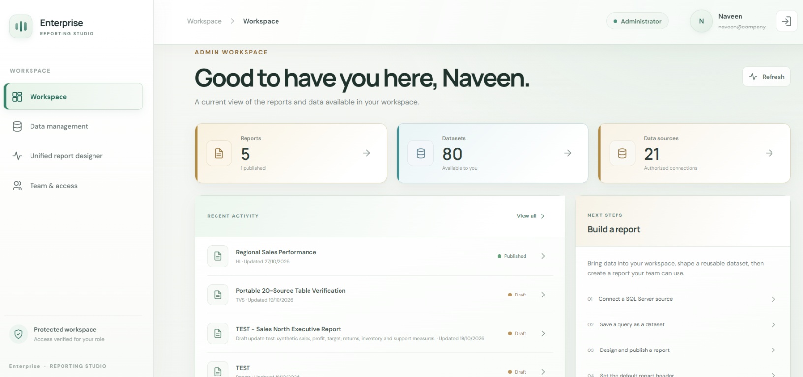
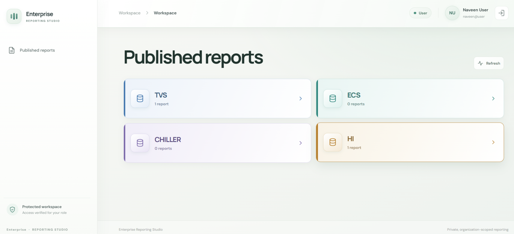

# Enterprise Reporting Studio

Enterprise Reporting Studio is a web-based reporting workspace for connecting
to SQL Server data, building reusable datasets, designing reports, and
publishing reports for role-authorized viewers.

## Application screenshots

### Administrator workspace



### Report viewer dashboard



## Features

- Tenant-scoped sign-in and Admin, Report Designer, and Report Viewer roles.
- SQL Server data-source management and reusable parameterized datasets.
- Single- and multi-source report design, joins, tables, charts, and parameters.
- Drafts, version history, publishing, report folders, and published viewing.
- Organization-wide report headers and PDF, CSV, and Excel-compatible exports.
- Portable report and dataset packages and supported Microsoft Report Builder
  RDL exchange.

## Requirements

- .NET 10 SDK.
- Node.js and npm.
- SQL Server containing the application metadata schema.
- A SQL identity authorized for the configured workspace and report sources.

The application metadata database and business data-source databases are
separate. Development defaults use Windows Integrated authentication with a
local SQL Server; production deployments should use a trusted SQL Server TLS
certificate and protected secret configuration.

## Run locally

From the project root in PowerShell:

```powershell
dotnet restore EnterpriseReporting.slnx
$key = [Convert]::ToBase64String([Security.Cryptography.RandomNumberGenerator]::GetBytes(48))
dotnet user-secrets set "Authentication:SigningKey" $key --project backend\EnterpriseReporting.Api\EnterpriseReporting.Api.csproj
dotnet run --project backend\EnterpriseReporting.Api\EnterpriseReporting.Api.csproj --launch-profile http
```

In a second terminal:

```powershell
Set-Location frontend
npm ci
npm run dev
```

The API listens on `http://localhost:5075` and Vite serves the frontend on
`http://localhost:5173`, proxying `/api` requests to the API. Configure
`ConnectionStrings__EnterpriseReportingDb` using .NET User Secrets or another
secure local configuration source. Never commit credentials or signing keys.

For a new, empty workspace database, provision the first administrator after
the database schema and connection are ready:

```powershell
dotnet run --project backend\EnterpriseReporting.Api\EnterpriseReporting.Api.csproj -- --provision-initial-admin
```

The command prompts for the tenant, administrator, and password. It runs only
when the tenant and user tables are empty; it does not create a default login
in the public source code.

For detailed setup and deployment steps, start at
[Local Development Setup](docs/LOCAL_DEVELOPMENT_SETUP.md) and
[Deployment Guide](docs/DEPLOYMENT_GUIDE.md).

## Documentation

| Guide | Description |
|---|---|
| [Project Overview](docs/PROJECT_OVERVIEW.md) | Scope, capabilities, and deployment model |
| [Architecture](docs/ARCHITECTURE.md) | Runtime components and dependency direction |
| [Frontend Guide](docs/FRONTEND_GUIDE.md) | User workflows and interface behavior |
| [API Reference](docs/API_REFERENCE.md) | API routes and constraints |
| [Authentication and Authorization](docs/AUTHENTICATION_AND_AUTHORIZATION.md) | Accounts, roles, tokens, and secrets |
| [Database Design](docs/DATABASE_DESIGN.md) | Workspace schema and persistence |
| [External SQL Server Connections](docs/EXTERNAL_SQL_SERVER_CONNECTIONS.md) | Business data-source setup |
| [Report Designer](docs/REPORT_DESIGNER.md) | Report authoring, export, and RDL support |
| [Versioning and Publishing](docs/REPORT_VERSIONING_AND_PUBLISHING.md) | Draft and publishing lifecycle |
| [Testing Guide](docs/TESTING_GUIDE.md) | Test commands and environment requirements |
| [Security](docs/SECURITY.md) | Security boundaries and deployment guidance |

## Project layout

```text
backend/
  EnterpriseReporting.Api/             ASP.NET Core API
  EnterpriseReporting.Application/     Application contracts and services
  EnterpriseReporting.Domain/          Domain layer
  EnterpriseReporting.Infrastructure/  SQL Server persistence
  EnterpriseReporting.Tests/           Backend and API tests
database/                               Workspace database assets
docs/                                   Product and technical documentation
frontend/                               React, TypeScript, and Vite application
```

## Health checks and tests

```powershell
Invoke-RestMethod http://localhost:5075/health/live
Invoke-RestMethod http://localhost:5075/health/ready
dotnet test backend\EnterpriseReporting.Tests\EnterpriseReporting.Tests.csproj --configuration Release
```

Readiness requires access to the configured metadata database. Tests that
exercise the reachable SQL Server require the same approved database access.
